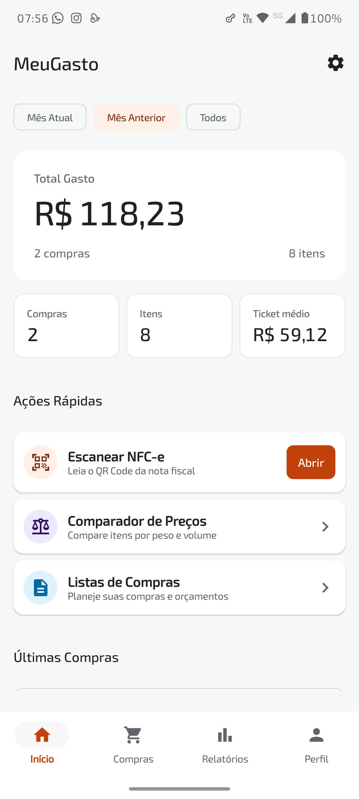
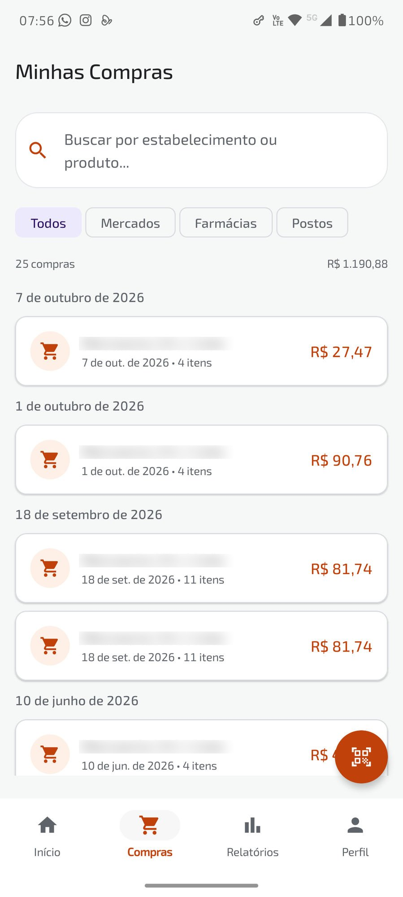
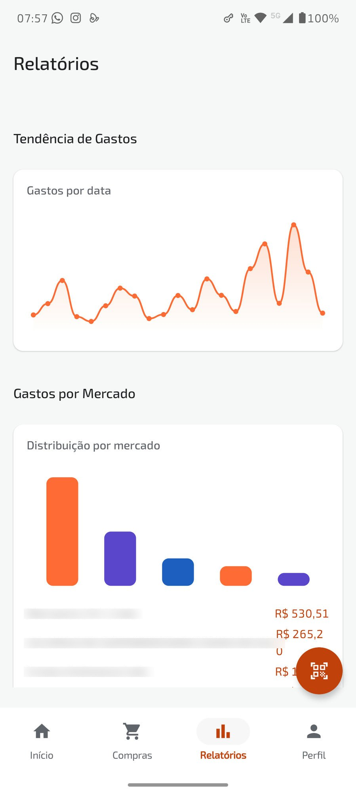

# MeuGasto

[](https://github.com/bashln/MeuGasto/actions/workflows/quality.yml)
[](LICENSE)


Aplicativo Android nativo para registrar compras de supermercado, farmácia e posto a partir do QR Code da NFC-e (Nota Fiscal de Consumidor Eletrônica), sem digitação manual de itens.

<p align="center">
  
  
  
</p>

Capturas com os nomes dos estabelecimentos ocultados.

## Visão geral e problema resolvido

Controlar gastos de supermercado exige registrar dezenas de itens por compra. Planilhas e apps financeiros genéricos dependem de entrada manual, o que faz o hábito morrer na segunda semana. O MeuGasto elimina essa etapa: o usuário escaneia o QR Code impresso no cupom, o app consulta o portal da SEFAZ do estado, extrai estabelecimento, data, itens, quantidades e preços, e grava tudo no banco local do aparelho. A partir daí o app calcula gastos por período, mercado e produto, com histórico de preços e comparação entre mercados.

O projeto adota privacidade como restrição arquitetural, não como promessa de marketing: o modo padrão é Local-First (dados só no dispositivo), o modo Nuvem é opcional e isolado por Row Level Security, e as tabelas de analytics não contêm identificador de usuário.

## Arquitetura e decisões técnicas

- **Android nativo, sem camada híbrida.** Kotlin 2.0 com Jetpack Compose e Material 3. O `applicationId` `com.prati.meugasto` e o keystore de release são invariantes do projeto, garantindo atualização contínua de instalações existentes.
- **Local-First com Room como único read model.** `Room` (SQLite) guarda compras, itens, mercados, listas e preços. Todas as telas leem os mesmos `Flow`s do repositório; o modo Nuvem espelha o remoto para o Room em vez de trocar o repositório em runtime. Isso evita telas vazias quando a rede falha.
- **Migrações versionadas e testadas.** O banco está na versão 7, com migrações explícitas 1→7 em `AppDatabase.kt`. Os schemas exportados ficam em `mobile/app/schemas/` e alimentam testes instrumentados com `MigrationTestHelper`.
- **Estratégia por estado para NFC-e.** `NfceScraperEngine` seleciona uma `NfceStateStrategy` (hoje Rio Grande do Sul e Rio de Janeiro) a partir da URL do QR Code. `NfceStateRegistry` resolve a UF pela chave de 44 dígitos ou pelo domínio `*.uf.gov.br`, promove portais conhecidos para HTTPS e rejeita URLs com credenciais embutidas ou esquema inválido.
- **Rede hostil por padrão.** O cliente Ktor/OkHttp desabilita redirects automáticos e valida cada salto contra a lista de hosts permitidos pela estratégia, bloqueando downgrade para HTTP e escape para domínios externos. A leitura do HTML tem teto de 2 MB e o payload passa por `NfcePayloadValidator` antes de virar compra.
- **Chave fiscal não fica em texto puro.** A chave de acesso de 44 dígitos é normalizada e reduzida a SHA-256 (`PurchaseAccessKeyHasher`) no aparelho. A migração 6→7 faz o backfill e apaga a coluna em claro, inclusive para linhas duplicadas que saem da fila de upload.
- **Sessão em armazenamento criptografado.** Access e refresh tokens usam `EncryptedSharedPreferences` com chaves no Android Keystore. Se o keyset corromper, o app recria o arquivo; se o Keystore falhar de forma permanente, a sessão cai para memória volátil e nunca grava token em disco aberto.
- **Nuvem com RLS e RPC que deriva o dono.** O cliente fala REST direto com Supabase/PostgREST via Ktor, sem SDK. A escrita principal usa `create_purchase_with_items`, que obtém o usuário de `auth.uid()`, valida limites e converte a chave NFC-e em HMAC-SHA-256 no servidor. A sobrecarga legada que aceitava `p_user_id` foi revogada e removida.
- **Analytics sem identidade.** As tabelas `analytics_*` não têm `user_id`, `purchase_id` nem e-mail, têm leitura revogada para `PUBLIC`, `anon` e `authenticated` e só são expostas a uma role agregadora. Um `CHECK` e a RLS exigem pelo menos cinco contribuidores por agregado (k-anonymity); a política completa está em [docs/architecture/privacy.md](docs/architecture/privacy.md).
- **Atualização in-app defensiva.** `InAppUpdateManager` consulta a API de releases do GitHub, aceita download apenas em `https://` de hosts oficiais, valida cada redirect, limita o tamanho, exige cabeçalho ZIP (`PK\x03\x04`) e compartilha o APK via `FileProvider` restrito a `cacheDir/updates/`.
- **Superfície mínima de permissões.** Apenas câmera e internet. `RECORD_AUDIO` é declarada com `tools:node="remove"` e o manifesto é verificado por script no CI.
- **Guardrails executáveis, não só documentação.** `scripts/privacy-check.sh` valida invariantes de SQL, RLS, permissões e FileProvider; `scripts/secret-scan.sh` varre arquivos rastreados e todo o histórico Git; `scripts/repo-hygiene-check.sh` bloqueia artefatos locais versionados, arquivos de credencial e padrões de CPF ou URL real de projeto Supabase, e tem teste de fixture próprio; `scripts/dependency-audit.mjs` aplica uma política de advisories com exceções datadas.
- **Dependências auditadas e Actions fixadas por SHA.** Dependabot atualiza npm e Actions na branch `dev`; o CI bloqueia vulnerabilidades altas/críticas fora das exceções datadas e emite aviso para pull requests acima de 30 arquivos ou 1.000 linhas alteradas.

### Estrutura do repositório

```text
.
├── .github/workflows/       # CI de qualidade e release assinado
├── docs/                    # Arquitetura, ADRs, segurança, produto
├── mobile/
│   ├── app/src/main/kotlin/ # Código da aplicação (data, domain, ui, update)
│   ├── app/src/test/        # 137 testes unitários (JVM)
│   ├── app/src/androidTest/ # Testes de migração Room e DAOs
│   ├── app/schemas/         # Schemas Room exportados por versão
│   └── gradle/              # Version catalog e wrapper
├── scripts/                 # Guardrails, auditoria e validação de release
└── supabase/migrations/     # Migrações SQL, RLS e funções privilegiadas
```

## Pré-requisitos e instalação rápida

Requisitos: JDK 17, Android SDK com `compileSdk 35` e as variáveis `ANDROID_HOME`/`ANDROID_SDK_ROOT` configuradas. Node.js 20 é necessário apenas para a auditoria de dependências. Não é preciso configurar Supabase para rodar testes ou usar o app em modo Local-First.

```bash
git clone https://github.com/bashln/MeuGasto.git
cd MeuGasto
make test
```

Para configurar o modo Nuvem em um build local:

```bash
cd mobile
cp .env.example .env   # preencha URL e anon key do seu projeto Supabase
cd ..
make build             # APK de debug
```

O `.env` é ignorado pelo Git. Sem credenciais, o app inicia em Local-First e o login na nuvem permanece indisponível, sem quebrar o restante do fluxo.

Alvos disponíveis:

```bash
make help        # lista os comandos
make guardrails  # privacidade, higiene do repositório e segredos (não exige SDK)
make audit       # política e auditoria de dependências npm
make test        # testes unitários Android
make build       # APK de debug
make apk         # APK de release assinado
```

## Uso e demonstração

1. Abra o app e permita o acesso à câmera.
2. Escaneie o QR Code do cupom NFC-e. O app resolve o estado, consulta o portal da SEFAZ e mostra a compra extraída para revisão.
3. Confirme. A compra passa a alimentar o dashboard, os relatórios por período e o histórico de preços por produto.
4. Opcionalmente, entre com uma conta para sincronizar entre aparelhos. A sincronização é idempotente por `remoteId`; falha de rede não apaga dados locais.

Release assinado localmente (as credenciais vêm do ambiente, nunca do repositório):

```bash
export MEUGASTO_STORE_FILE=/caminho/para/meugasto-release.jks
export MEUGASTO_STORE_PASSWORD=...
export MEUGASTO_KEY_ALIAS=...
export MEUGASTO_KEY_PASSWORD=...
make apk
```

O APK sai em `mobile/app/build/outputs/apk/release/`. Releases oficiais são geradas pelo workflow `release.yml` a partir de tags `vX.Y.Z.W`, com validação de versão, verificação de assinatura e publicação do artefato no GitHub Releases.

<!-- TODO: Adicionar screenshot da tela de scanner NFC-e -->
<!-- TODO: Adicionar screenshot do dashboard com gastos por período -->
<!-- TODO: Adicionar screenshot da comparação de preços entre mercados -->

### Cobertura NFC-e

Disponível para Rio Grande do Sul (RS) e Rio de Janeiro (RJ). Os demais estados ainda não são suportados por falta de amostras de QR Code de NFC-e para estudo e implementação. Cada novo estado exige uma estratégia de parsing própria e testes contra o HTML real do portal; a lista de pendências fica em [AGENTS.md](AGENTS.md).

### Verificação

- 137 testes unitários JVM cobrindo parser NFC-e, normalização monetária, estratégias estaduais, validação de payload, sincronização em nuvem, comparação de preços e atualizador in-app.
- Testes instrumentados de migração Room (1→7), DAOs e reconciliação de compras em nuvem.
- CI (`.github/workflows/quality.yml`): guardrails de privacidade, higiene do repositório com teste do próprio guard, varredura de segredos, auditoria de dependências, testes unitários e compilação dos testes instrumentados em cada push/PR para `dev` e `main`.

## Documentação

- [Arquitetura de privacidade](docs/architecture/privacy.md)
- [ADR 0001 — administração sem acesso aos gastos](docs/adr/0001-admin-blind-e2ee.md)
- [Política de segurança](SECURITY.md)
- [Política de auditoria de dependências](docs/security/dependency-audit-policy.md)
- [Índice da documentação](docs/README.md)

## Licença

Distribuído sob a GNU AGPLv3. Consulte [LICENSE](LICENSE).
